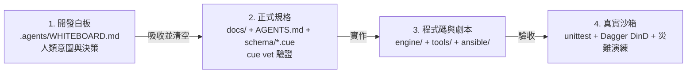

# Antigravity Vibe Coding 與 AI 輔助 SRE

**OpenLabOps** 全專案皆透過 **Google Antigravity (AGY) Vibe Coding** 開發完成——由人類架構師定義硬性不變量與設計意圖，並由 AI 代理人於嚴格邊界內負責實作、測試與端到端驗證。

---

## 1. 人機協作開發模式

傳統的 Vibe Coding 在基礎設施專案上容易出現套件膨脹、架構漂移與跳過測試等問題。OpenLabOps 透過三大機制讓 AI 開發既快速又可控：

### A. 機器可讀工程契約 (`AGENTS.md`)
所有架構紀律皆寫入 `AGENTS.md` 作為不可妥協的不變量：
* **零外部依賴 (`[INV-01]`)**：強制 AI 僅使用 Python 3 標準函式庫。
* **零明文憑證 (`[INV-02]`)**：嚴禁 AI 寫死或提交任何私鑰與 Token。
* **正式工具驗證 (`[INV-09]`)**：禁止 AI 編寫造假測試或吞滅例外，所有修改必須在真實 Docker/Dagger 沙箱通過。

### B. 規格先行三階段流水線 (`[INV-10]`)



1. **白板輸入**：人類開發者將想法或需求寫入 `.agents/WHITEBOARD.md`。
2. **文件與規格對齊**：AI 先將決策整合進正式 `docs/` 與 `schema/*.cue`（通過 `cue vet ./schema/`），隨即清空白板。
3. **實作與真實驗證**：規格確定後才修改 Python/Ansible 程式碼，並於單元測試與 Dagger 沙箱驗證。

---

## 2. 利用現有邊界讓 `AGY-Remote` 安全參與 SRE

正因為 OpenLabOps 在架構層已建立嚴密的安全與權限邊界，你可以放心地將 **AGY-Remote** 納入 Homelab 擔任 AI SRE 維運助手，而不必擔心權限失控。

### 部署 `AGY-Remote`
在 Day-0 初始化時加上 `--with-remote-dev` 即可建立遠端開發與 SRE 容器：
```bash
lab-init --with-remote-dev
```

### 硬性邊界如何保護你的集群

| 防護邊界 | 對 AI SRE (`AGY-Remote`) 的安全保障 |
| :--- | :--- |
| **零明文私鑰 (`[INV-02]`)** | `AGY-Remote` 本身不持有 `ansible.key` 或管理員私鑰，所有特權變更一律經由 Gitea Actions（`openlab-workflows`）派發。 |
| **Token 爆破半徑隔離 (`[INV-03]`)** | 自動化帳號（`ci-bot`）僅能觸發工作流與寫入 CMDB 遙測（`openlab-configs`），**物理上無法篡改** `openlab-operations` 核心劇本。 |
| **結構化唯讀遙測** | `AGY-Remote` 可透過 `lab-status --json`、`lab-status -a`（金鑰稽核）與 `node-information/node_*.json` 即時掌握全網健康度。 |
| **非互動式 CLI 介面** | 工具支援 `--plain` / `--no-tui` / `--json`（例如 `lab-tools --plain inspect-run <ID>`），讓 AI SRE 能直接診斷 CI/CD 失敗日誌並派發修復工作流。 |
| **CUE 與防鎖死護欄** | `cue vet ./schema/` 在部署前阻擋非法網段或角色變更，而 `lab-boot-sync` 與三階段金鑰輪替則確保 AI 操作絕不會鎖死人類管理員。 |
