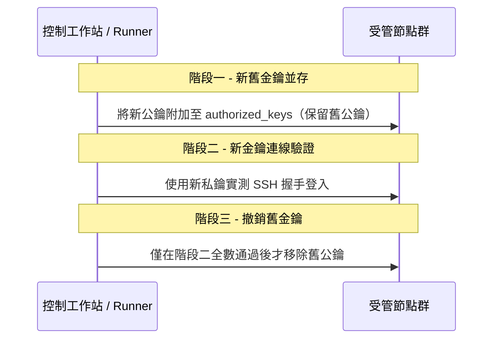

# 安全政策與金鑰生命週期

OpenLabOps 在控制工作站、GitOps 聯邦與受管 Linux 節點之間，強制落實零信任與零明文憑證原則。

## 1. 倉庫零憑證原則

* **禁止提交私鑰與 Token**：任何私鑰（`*.key`、`id_*`）或 API Token 嚴禁進入 Git 倉庫。
* **原生 OpenSSH 整合**：所有工具直接呼叫工作站既有之 `~/.ssh/`、`~/.ssh/config` 與執行中的 `ssh-agent`。
* **Token 爆破半徑隔離**：`ci-bot` 僅具備派發工作流與寫入 `openlab-configs` 遙測之權限，無法更動 `openlab-operations` 核心劇本。

## 2. 標準金鑰語意角色

核心程式與劇本一律透過語意角色調用金鑰，並由 `conf/openlab.manifest.yml` 映射實體檔名：

| 角色 | 用途 | 常見對應檔名 |
| :--- | :--- | :--- |
| **`ansible`** | Gitea Act Runner 與 Ansible 劇本專用自動化金鑰 | `ansible.key` |
| **`user`** | 維運管理員互動式登入金鑰 | `admin.key` |
| **`git`** | GitOps 倉庫同步與部署專用金鑰 | `git-openlab.key` |

端點工作站（`dev` / `desktop`）則透過 `generate-host-ssh-key` 依主機名稱動態生成獨立金鑰（`<hostname>.key`），除役時可透過 `revoke-host-ssh-key` 一鍵全網撤銷。

## 3. 三階段零停機金鑰輪替

執行金鑰輪替（`lab-ssh --rotate-ansible` / `--rotate-all`）時，Ansible 會嚴格執行三階段流水線以杜絕斷線鎖死：

若階段二於任何節點失敗，階段三將立即中止，確保管理通道永遠暢通。

## 4. `authorized_keys` 來源限制與後門稽核

* **來源 IP 鎖定**：自動化金鑰保留 `from="..."` 來源限制參數。
* **即時後門偵測 (`lab-status -a`)**：掃描全網受管節點帳號之 `authorized_keys`，比對指紋與合法清單，即時揪出未經授權之異常公鑰。

## 5. 開機公鑰同步與鎖定防護 (`lab-boot-sync`)

在受管的 `dev` 與 `desktop` 端點上，`lab-boot-sync` 用於防止離線或輪替後的金鑰不同步鎖死：

1. 比對本機與遠端 `openlab-secrets` 最新 Commit SHA（`--check`）。
2. 若版本落後，自動派發 Gitea Actions 金鑰部署工作流（`--force` / `--wait`）並等待收斂。
3. 驗證完成後寫入 `/run/openlab/synced_ok`，通知鎖定防護模組（`tools/lib/core/lockout.py`）安全解鎖。
