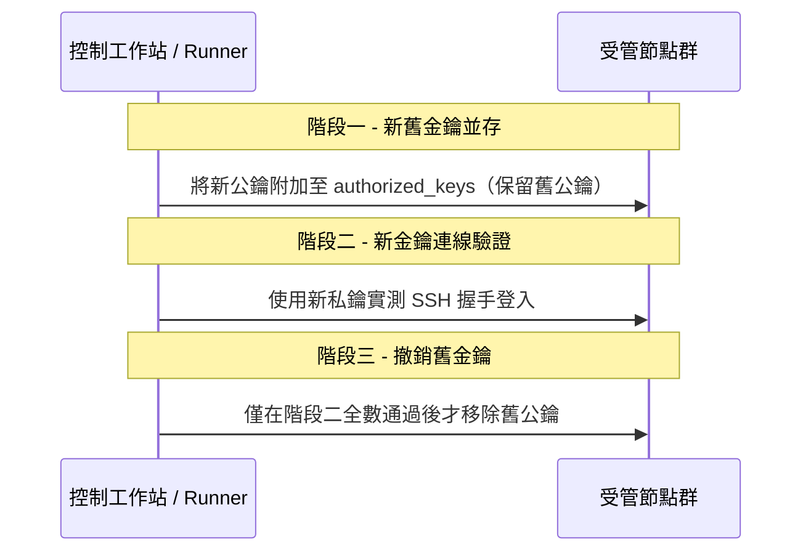
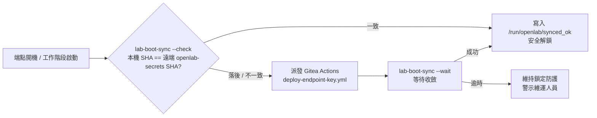

# 安全政策與金鑰生命週期

OpenLabOps 在控制工作站、GitOps 聯邦與受管 Linux 節點之間，強制落實零信任與零明文憑證原則。

## 1. 倉庫零憑證原則 (`[INV-02]`)

* **禁止提交私鑰與 Token**：任何私鑰（`*.key`、`id_*`）或 API Token 嚴禁進入 Git 倉庫。
* **原生 OpenSSH 整合**：所有工具直接呼叫工作站既有之 `~/.ssh/`、`~/.ssh/config` 與執行中的 `ssh-agent`。
* **Token 爆破半徑隔離**：`ci-bot` 僅具備派發工作流與寫入 `openlab-configs` 遙測之權限，無法更動 `openlab-operations` 核心劇本。

## 2. 標準金鑰語意角色與端點金鑰

核心程式與劇本一律透過語意角色調用金鑰，並由 `conf/openlab.manifest.yml` 映射實體檔名：

| 角色 | 用途 | 常見對應檔名 | 輪替指令 |
| :--- | :--- | :--- | :--- |
| **`ansible`** | Gitea Act Runner 與 Ansible 劇本專用自動化金鑰 | `ansible.key` | `lab-ssh --rotate-ansible` |
| **`user`** | 維運管理員互動式登入金鑰 | `admin.key` | 由 `~/.ssh/` 管理 |
| **`git`** | GitOps 倉庫同步與部署專用金鑰 | `git-openlab.key` | `lab-ssh --rotate-git` |

### 端點工作站金鑰生命週期
* **簽發 (`generate-host-ssh-key -H <hostname>`)**：於端點產生專屬 Ed25519 金鑰對（`<hostname>.key`），將公鑰註冊至 `openlab-secrets`，並透過 Gitea Actions 派發 `ansible/playbooks/deploy-endpoint-key.yml`。
* **撤銷 (`revoke-host-ssh-key -H <hostname>`)**：透過 `ansible/playbooks/revoke-host-key.yml` 立即自全網受管節點的 `authorized_keys` 抹除該端點公鑰，並從 `openlab-secrets` 移除（除非指定 `--keep-secrets`）。

## 3. 三階段零停機金鑰輪替

執行金鑰輪替（`lab-ssh --rotate-ansible` / `--rotate-all`）時，Ansible 嚴格執行三階段流水線（`rotate_stage1_add.yml`、`rotate_stage2_verify.yml`、`rotate_stage3_remove.yml`）以杜絕斷線鎖死：

若階段二於任何節點失敗，階段三將立即中止，確保管理通道永遠暢通。

## 4. SSH 強化、來源限制與後門稽核

* **來源 IP 鎖定**：自動化金鑰保留 `from="..."` 來源限制參數。
* **SSHD 與 2FA 基線**：`ansible/roles/baseline/tasks/sshd.yml` 與 `sshd_2fa.yml`（經由 `harden-ssh-2fa.yml` 派發）強制純金鑰驗證、停用 root 密碼登入並支援 2FA 設定。
* **即時後門偵測 (`lab-status -a`)**：掃描全網受管節點帳號之 `authorized_keys`，比對 SHA-256 指紋與合法清單，即時揪出未經授權之異常公鑰。

## 5. 開機公鑰同步與鎖定防護 (`lab-boot-sync`)

在受管的 `dev` 與 `desktop` 端點上，`lab-boot-sync` 用於防止離線或輪替後的金鑰不同步鎖死：

