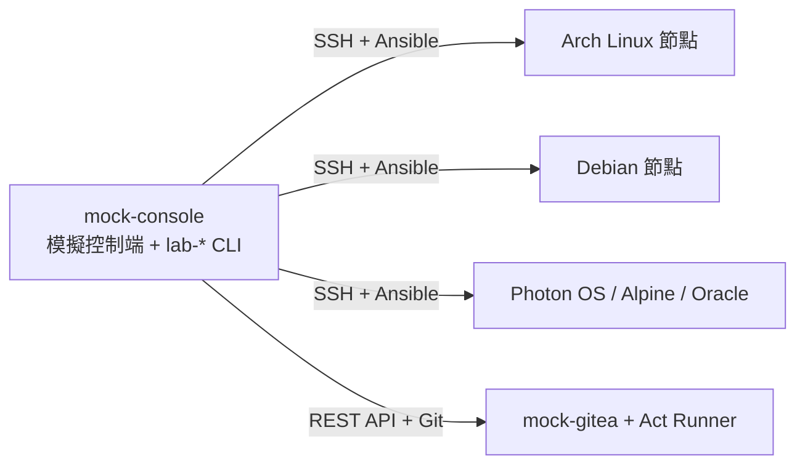

# 測試方法與沙箱原理

OpenLabOps 拒絕僅以 Mock 假資料通過測試，所有發行版本皆必須在真實多發行版容器與隔離的 Dagger 流水線中，由真實 CLI 工具端到端驗證。

## 1. 核心測試原則

* **正式工具驗證原則**：Dagger 與容器沙箱的唯一目的，是從零環境直接執行真實生產工具（`bin/lab-init`、`bin/lab-node`、`engine/classifier.py`、`tools/bin/lab-*`）。
* **零造假契約**：測試腳本嚴禁吞滅例外或將失敗偽造為通過；任何非零結束碼或斷言失敗皆立即阻斷並輸出完整日誌。
* **網域隔離與無痕清理**：測試沙箱使用獨立網域（`mock-gitea`、`gitea.mock`），並在結束時自動清除所有 `/tmp/` 暫存產物。

## 2. 五層驗證架構

### 第一層：規格與語法驗證
* **`cue vet ./schema/`**：驗證網段定義（`network.cue`）、節點角色（`roles.cue`）、金鑰合約（`keys.cue`）與系統不變量（`invariants.cue`）。
* **`ansible-playbook --syntax-check`**：檢查 `ansible/playbooks/` 下所有劇本語法。

### 第二層：Python 單元測試
* `python3 -m unittest discover -s tests/unit`（`tests/unit/test_core_units.py`）驗證：
  * 內建零依賴 YAML 解析器與 Manifest 載入
  * 多語系 i18n 字典完整性（`en_US`、`zh_TW`、`ja_JP`）
  * 節點分類與庫存編譯（`engine/classifier.py`）
  * 主機名稱注入防護與 SemVer 版本比對

### 第三層：多發行版 Docker 沙箱 (`lab-test`)

* **`tests/sandbox/docker-compose.yml`**：啟動 `mock-console`、`mock-gitea`、內建 `ansible-core` 的 Act Runner，以及多種 Linux 節點映像（`Dockerfile.arch`、`Dockerfile.debian`、`Dockerfile.alpine`、`Dockerfile.photon`、`Dockerfile.oracle`）。
* **控制台內核檢測**：所有部署與納管操作一律進入 `mock-console` 容器內部執行，嚴禁從外部宿主機旁路檢查。
* **PTY 人工操作模擬器 (`tests/sandbox/simulate_human_operator.py`)**：透過真實偽終端（PTY）自動驅動 `lab-init` 互動選單，驗證完整 TUI 流程。

### 第四層：Dagger DinD 流水線 (`lab-test --dagger`)
* `tests/e2e/test_dagger.py` 於獨立 Docker-in-Docker 環境中自動執行：啟動沙箱與 `mock-gitea` $\rightarrow$ 執行 `lab-init` $\rightarrow$ 驗證 `lab-node`、`lab-discover`、`lab-status` 與 `lab-ssh` $\rightarrow$ 自動銷毀。

### 第五層：SHA-256 災難復原演練 (`lab-test --dr`)
* `tests/sandbox/dr_drill.sh`（可由 `lab-test --dr <target>` 觸發）：植入哨兵檔案並計算 SHA-256 $\rightarrow$ 執行 `lab-backup` 備份 $\rightarrow$ 模擬節點毀損抹除 $\rightarrow$ 執行 `ansible/playbooks/restore-node.yml` 還原並驗證 SHA-256 100% 一致。
