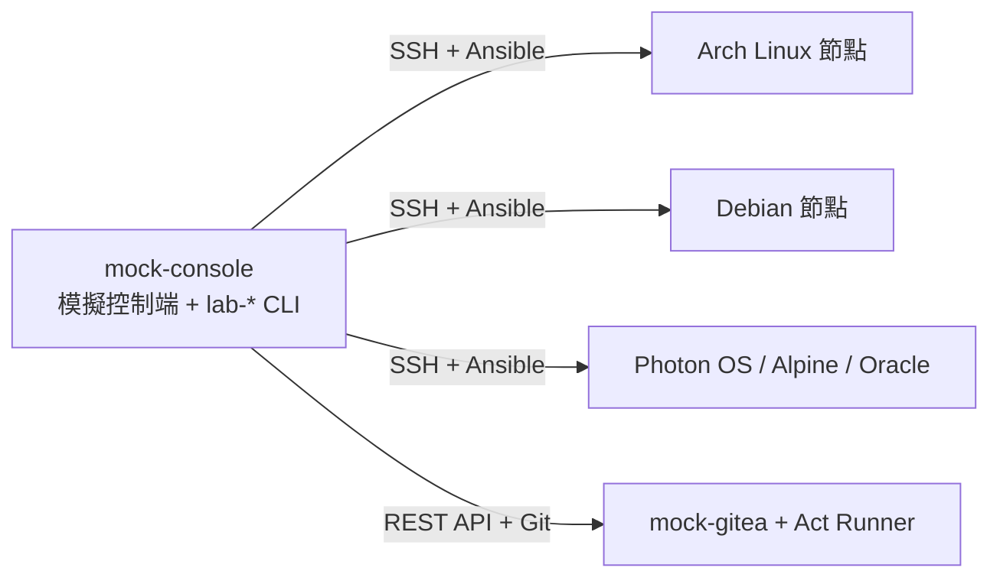

# 測試方法與沙箱原理

OpenLabOps 拒絕僅以 Mock 假資料通過測試，所有發行版本皆必須在真實多發行版容器與隔離的 Dagger 流水線中，由真實 CLI 工具端到端驗證。

## 1. 核心測試原則 (`[INV-09]`)

* **正式工具驗證原則**：Dagger 與容器沙箱的唯一目的，是從零環境直接執行真實生產工具（`bin/lab-init`、`bin/lab-node`、`engine/classifier.py`、`tools/bin/lab-*`），嚴禁在正式程式碼中加入測試專用旁路。
* **零造假契約**：測試腳本嚴禁吞滅例外（`try...except: return True`）或將失敗偽造為通過；任何非零結束碼或斷言失敗皆立即阻斷並輸出完整日誌。
* **網域隔離與無痕清理**：測試沙箱使用獨立網域（`mock-gitea`、`gitea.mock`）避免與實體集群衝突，並在結束時自動清除所有 `/tmp/` 暫存產物。

## 2. 五層驗證矩陣

| 層級 | 指令 / 入口 | 驗證範圍 |
| :--- | :--- | :--- |
| **1. 規格與語法** | `cue vet ./schema/` 與 `ansible-playbook --syntax-check` | 網段 CIDR、角色與金鑰不變量、全數 Ansible 劇本語法 |
| **2. Python 單元測試** | `python3 -m unittest discover -s tests/unit` | 內建 YAML 解析器、多語系完整性、`classifier.py`、SemVer 與注入防護 |
| **3. 多發行版沙箱** | `lab-test --manual` / `lab-test --auto` | `mock-console`、`mock-gitea`、Act Runner 與 Arch/Debian/Alpine/Photon/Oracle 容器 |
| **4. Dagger DinD E2E** | `lab-test --dagger`（`tests/e2e/test_dagger.py`） | 隔離 DinD 環境下之 Day-0 全新納管與工具鏈端到端驗收 |
| **5. SHA-256 災難演練** | `lab-test --dr [target]`（`tests/sandbox/dr_drill.sh`） | 備份、模擬節點毀損、`restore-node.yml` 還原與 100% SHA-256 校驗 |

## 3. 多發行版 Docker 沙箱 (`lab-test`)

* **`tests/sandbox/docker-compose.yml`**：啟動 `mock-console`、`mock-gitea`、內建 `ansible-core` 的 Act Runner，以及多種 Linux 節點映像（`Dockerfile.arch`、`Dockerfile.debian`、`Dockerfile.alpine`、`Dockerfile.photon`、`Dockerfile.oracle`）。
* **控制台內核檢測**：所有部署與納管操作一律進入 `mock-console` 容器**內部**執行，嚴禁從外部宿主機旁路檢查；`--manual` 模式會在最後自動執行 `docker exec -it mock-console bash`。
* **工作區即時同步 (`tests/bin/test-gitea-init`)**：推送至 `mock-gitea` 時自動將未提交的工作區修改一併同步，確保 Runner 不會測到過期 `HEAD`。
* **PTY 人工操作模擬器 (`tests/sandbox/simulate_human_operator.py`)**：透過真實偽終端（PTY）自動驅動 `lab-init` 互動選單，涵蓋 `en_US`、`zh_TW` 與 `ja_JP` 語系。

## 4. SHA-256 災難復原演練 (`dr_drill.sh`)

1. **植入哨兵**：於目標節點建立測試設定檔並記錄 SHA-256 雜湊值。
2. **執行備份**：透過 `lab-backup` 將節點與閘道器狀態備份至 GitOps 儲存庫。
3. **模擬毀損**：刪除目標容器上的哨兵檔案模擬資料遺失。
4. **還原與校驗**：執行 `ansible/playbooks/restore-node.yml` 還原並驗證 SHA-256 與步驟 1 完全一致。
